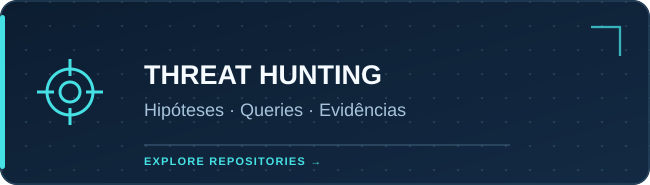
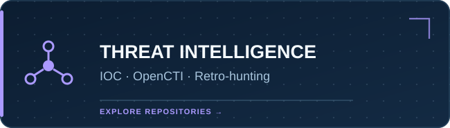
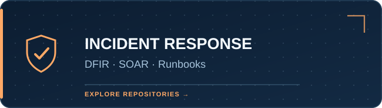
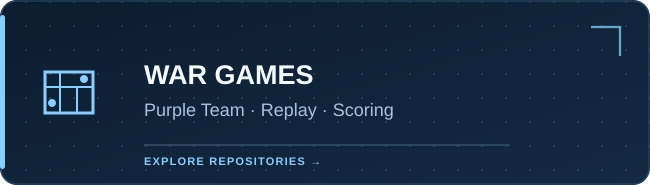
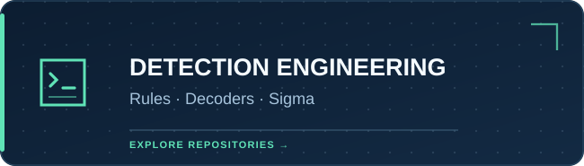
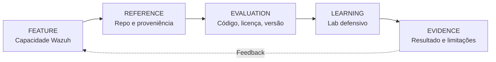
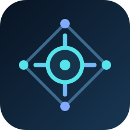

<div align="center">


<br/>

[](catalog/repositorios.csv)
[](catalog/funcionalidades.md)
[](docs/trilhas.md)
[](docs/metodologia.md)
[](.github/workflows/catalog-validation.yml)

**Um atlas de recursos, integrações e experiências práticas do ecossistema Wazuh.**

[**Explorar funcionalidades**](catalog/funcionalidades.md) · [**Ver todas as referências**](catalog/README.md) · [**Trilhas guiadas**](docs/trilhas.md) · [**Sugerir repositório**](CONTRIBUTING.md)

</div>

---

## 01 / Navegue pelas áreas

Em vez de misturar ferramentas, conceitos e laboratórios em uma lista interminável, o atlas organiza as referências por **capacidade operacional**. Cada área explicita o que existe, o que realmente pode ser aproveitado e o que ainda precisa de validação.

<table>
<tr>
<td width="50%" valign="top">
  <a href="catalog/threat-hunting.md"></a>
  <sub>Process trees, investigações orientadas por hipóteses, consultas DQL/DSL, timelines e DFIR.</sub>
</td>
<td width="50%" valign="top">
  <a href="catalog/cti-retrohunting.md"></a>
  <sub>OpenCTI, MISP, STIX/TAXII, enriquecimento e busca retrospectiva com limites de consulta.</sub>
</td>
</tr>
<tr>
<td valign="top">
  <a href="catalog/incident-response.md"></a>
  <sub>Case management, DFIR-IRIS, Shuffle, playbooks executáveis, revisão humana e trilhas de auditoria.</sub>
</td>
<td valign="top">
  <a href="catalog/war-games.md"></a>
  <sub>Exercícios defensivos, tabletop, replay de telemetria sintética, scorecards e melhoria contínua.</sub>
</td>
</tr>
<tr>
<td valign="top">
  <a href="catalog/detection-engineering.md"></a>
  <sub>Detection-as-Code, regras XML, decoders, conversão Sigma, consultas e testes de regressão.</sub>
</td>
<td valign="top">
  <a href="catalog/plataforma.md"></a>
  <sub>Arquitetura Wazuh, Docker, Kubernetes, Ansible, observabilidade, SOAR e copilotos read-only.</sub>
</td>
</tr>
</table>

<details>
<summary><b>Mapa adicional: funcionalidades nativas e extensões</b></summary>

A [matriz completa](catalog/funcionalidades.md) distingue **FIM, SCA, Syscollector, vulnerabilidades, logcollector, decoders, Active Response e wazuh-logtest** de tecnologias externas como Suricata, Velociraptor, MISP, OpenCTI e Shuffle.

Essa distinção evita chamar de funcionalidade nativa uma integração de terceiros.

</details>

## 02 / O que torna esta curadoria diferente?

<table>
<tr>
<td width="33%" valign="top"><b>01. Contexto funcional</b><br/><sub>Cada ferramenta é associada a um problema real do SOC, não apenas a uma categoria genérica.</sub></td>
<td width="33%" valign="top"><b>02. Proveniência</b><br/><sub>Links de origem, tipo de artefato e limitações documentadas sem incorporação de código externo.</sub></td>
<td width="33%" valign="top"><b>03. Validação honesta</b><br/><sub>Existência e README verificados não são apresentados como prova de compatibilidade ou produção.</sub></td>
</tr>
</table>



## 03 / Destaques técnicos

| Projeto | Área | O que vale estudar |
|---|---|---|
| [WAZUH Process Tree Viewer](https://github.com/mym0us3r/WAZUH-Process-Tree-Viewer) | Hunting / DFIR | Visualização de processos e investigação baseada em telemetria Windows |
| [Wazuh-TI](https://github.com/federicofantini/Wazuh-TI) | CTI | TAXII, CDB e retro-hunting limitado e contextualizado |
| [SOCFortress Wazuh-Rules](https://github.com/socfortress/Wazuh-Rules) | Detection | Regras e decoders para múltiplas fontes |
| [Hotwash](https://github.com/lidless-labs/hotwash) | Incident Response | Runbooks visuais com decisões, tarefas e evidências |
| [Wazuh Detection Rules Kit](https://github.com/KaanTuran28/Wazuh-Detection-Rules-Kit) | Detection / Hunting | Regras XML, linter e queries em OpenSearch |
| [Purple Team Certification Lab](https://github.com/mrjmriii/purple-team-certification-lab) | Validação | Estruturação de exercícios e rubricas |
| [Wazuh SOC Enterprise](https://github.com/brunoflausino/wazuh-soc-enterprise) | SOC / DFIR | Casos documentados, integrações e evidências |
| [SOCFortress Wazuh MCP Server](https://github.com/socfortress/wazuh-mcp-server) | IA / Automação | Interface MCP e controles de ferramentas |

**Catálogo completo:** [inventário CSV com 34 referências](catalog/repositorios.csv), [índice por domínios](catalog/README.md) e [metodologia](docs/metodologia.md).

## 04 / Aprenda por entregáveis

| Trilha | Exemplo de entrega | Guia |
|---|---|---|
| **01 · Detection Engineering** | Detector documentado, fixtures positivas/negativas e evidência de validação | [Iniciar](docs/trilhas.md#trilha-1--detection-engineering) |
| **02 · Threat Hunting** | Hipótese, queries, timeline e cadeia de evidências | [Iniciar](docs/trilhas.md#trilha-2--hunting-por-hipótese) |
| **03 · CTI / Retro-Hunting** | IOC sintético, busca histórica delimitada e avaliação de match | [Iniciar](docs/trilhas.md#trilha-3--cti-e-retro-hunting) |
| **04 · Incident Response** | Caso simulado, runbook e retrospectiva | [Iniciar](docs/trilhas.md#trilha-4--ir-guiado-por-runbook) |
| **05 · Blue Team War Game** | Eventos sintéticos, scorecard, after-action review | [Iniciar](docs/trilhas.md#trilha-5--blue-team-war-game-de-mesa) |
| **06 · Platform Engineering** | Arquitetura, controles e checklist de confiabilidade | [Iniciar](docs/trilhas.md#trilha-6--arquitetura-e-confiabilidade) |

> [!IMPORTANT]
> **Catálogo não é certificação de funcionamento.** Os repositórios externos foram examinados como referências documentais, mas **não foram executados nesta curadoria**. Confirme versões, licenças, comportamento e segurança no seu próprio laboratório autorizado.

## 05 / Use e contribua via GitHub

- **Explore:** comece pelo [índice completo](catalog/README.md) ou pela [matriz de funcionalidades](catalog/funcionalidades.md).
- **Pesquise:** filtre [`catalog/repositorios.csv`](catalog/repositorios.csv) por `primary_domain`, `tier`, `artifact_type` e `verification`.
- **Contribua:** use o [guia de contribuição](CONTRIBUTING.md) e envie uma sugestão com fontes, tipo de artefato e limitações.
- **Verifique:** o fluxo de [CI](.github/workflows/catalog-validation.yml) confere duplicações do catálogo, metadados e links Markdown internos.
- **Personalize o design:** veja os [assets e o design system](docs/design-system.md).

```bash
git clone https://github.com/Ridd1kulusC0d3r/wazuhfeature.git
cd wazuhfeature
python scripts/validate_catalog.py
```

## 06 / Fontes oficiais e transparência

A documentação primária permanece em [Wazuh Documentation](https://documentation.wazuh.com/current/), [wazuh/wazuh](https://github.com/wazuh/wazuh) e [wazuh/integrations](https://github.com/wazuh/integrations).

O atlas **não é afiliado, patrocinado, mantido ou endossado pela Wazuh**. Sua marca visual é original, sem reprodução do logotipo oficial. Os nomes e marcas de terceiros pertencem a seus respectivos titulares. Para reuso de código, consulte licenças e mantenedores.

<div align="center">



**Discover the feature. Understand the evidence.**

<sub>Independent GitHub knowledge project · Curadoria documental · PT-BR</sub>

</div>
