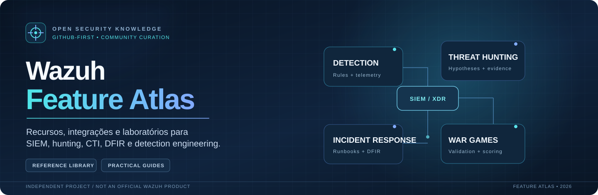

# Feature Atlas / Identidade visual

> Guia editorial para o **repositório GitHub**, não para um dashboard Wazuh.

## Direção visual

**Conceito:** *signal-to-evidence*. A estrutura de radar, nós e trilhas representa o caminho de uma funcionalidade a um conhecimento verificável. A marca foi criada como identidade própria do **Feature Atlas**, sem incorporar o símbolo ou logotipo oficial Wazuh.

**Direção:** interface técnica, sóbria, legível e moderna. Preferir orientação e clareza a banners animados, excesso de badges ou imagens que roubem atenção do catálogo.

## Tokens

| Função | Cor | Aplicação |
|---|---|---|
| Base deep navy | `#081322` | Superfícies da capa |
| Surface navy | `#10243E` | Cards e background |
| Secondary surface | `#132A43` | Tiles temáticos |
| Cyan signal | `#54E4E9` | Marca original, hunting e orientação |
| Blue intelligence | `#82AAFF` | Conexões e realces |
| Main text | `#F6FBFF` | Títulos sobre fundos escuros |
| Muted text | `#A7C4DC` | Descrições |
| Risk amber | `#EBA960` | Alertas editoriais, não decorativos |

Os cartões possuem acentos funcionais: hunting cyan, CTI lavender, IR warm orange, war games blue, detecção mint e infraestrutura amber.

## Elementos

| Asset | Uso |
|---|---|
| [`feature-atlas-hero.svg`](assets/feature-atlas-hero.svg) | Capa principal README, 1440 × 470 |
| [`feature-atlas-mark.svg`](assets/feature-atlas-mark.svg) | Marca independente, 220 × 220 |
| [`card-hunting.svg`](assets/card-hunting.svg) | Navegação por hunting |
| [`card-cti.svg`](assets/card-cti.svg) | Navegação por CTI |
| [`card-ir.svg`](assets/card-ir.svg) | Navegação por incident response |
| [`card-war.svg`](assets/card-war.svg) | Navegação por war games |
| [`card-detection.svg`](assets/card-detection.svg) | Navegação por engenharia de detecção |
| [`card-platform.svg`](assets/card-platform.svg) | Navegação por plataforma |

Todos os assets são vetores locais, sem fontes incorporadas, scripts, webfonts, GIFs ou rastreadores. O README utiliza apenas recursos suportados pelo GitHub: SVG local, tabelas HTML simples, detalhes expansíveis, badges e Mermaid.

## Hierarquia editorial

1. **Capa curta e legível:** quem é, para que serve, sem declarar afiliação.
2. **Navegação visual clicável:** máximo 6 domínios na página inicial.
3. **Tabela de destaque:** referências selecionadas, com link de origem.
4. **Trilhas didáticas:** quais artefatos o leitor produzirá.
5. **Transparência e contribuição:** verificações, licenças, critérios e restrições.

## Regras para futuras alterações

- Não desenhar símbolos parecidos com a marca Wazuh nem sugerir endosso oficial.
- Não repetir “Wazuh” em múltiplos selos decorativos, nem alegar título de ambassador.
- Evitar imagens externas de autores sem permissão, banners que dependam de JS e SVGs com elementos ativos.
- No Markdown, use títulos e links descritivos. Cores não podem ser o único significado.
- Se uma referência não passou por execução real, rotular como **curadoria documental**.
- Ao alterar links locais e assets, executar `python scripts/validate_catalog.py`.

### Transparência de autoria

Os assets desta identidade e a composição do README foram criados **com assistência de IA**, a pedido do mantenedor. Essa autoria deve ser tratada de modo transparente. Não apresentar estes materiais como contribuições autorais elegíveis ao Wazuh Ambassadors Program, cuja versão atual de regras veta conteúdo gerado por IA.

Fontes: [Política de marcas da Wazuh](https://wazuh.com/legal-resources/trademark-overall-guidelines/) · [Regras do programa](https://wazuh.com/legal-resources/ambassadors-program-rules/).
